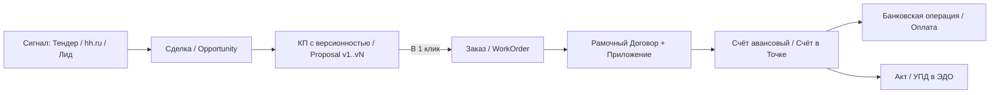

# 🇷🇺 EspoCRM Russian B2B & Engineering ERP Pack (by RD[AI])

[](LICENSE)
[](https://www.espocrm.com/)
[](https://www.php.net/)
[](https://enter.tochka.com/doc/v2/)
[](https://docs.perplexity.ai/)

> **Open-source B2B ERP & RevOps architecture for [EspoCRM](https://github.com/espocrm/espocrm)** tailored for Russian engineering, R&D, manufacturing, and B2B service companies — replacing bloated Bitrix24 / amoCRM setups with a fast, self-hosted, AI-native system.
>
> **Открытая архитектура и набор модулей для превращения [EspoCRM](https://github.com/espocrm/espocrm) в полноценную B2B ERP+CRM систему** для инженерного, производственного и проектного бизнеса в РФ: с прямой интеграцией банка **Точка**, деревом договорного документооборота (`Договор → Приложение → Заказ → Счёт → Акт/УПД`), автосверкой ЭДО, двусторонним Telegram-ботом, производственным календарём РФ и ИИ-маршрутизацией писем через **Perplexity Sonar API**.

Разработано и используется в production в инженерном центре **[RD\[AI\] (rdai.pro)](https://rdai.pro)** (паспортизация промышленного оборудования, разработка РЭ/КД по ГОСТ Р 2.601 / 2.610, нормализация НСИ/MDM и промышленный ИИ).

---

## ✨ Ключевые возможности / Key Modules

### 1. 🌳 Сквозное дерево договорного документооборота РФ (`DocumentTree` + `Proposal` + `WorkOrder`)
В отличие от коробочных CRM, где «Сделка» обрывается после продажи, пакет выстраивает сквозную финансовую и производственную цепочку:



- **Версионность КП (`Proposal`):** автонумерация `КП-26-001` → `КП-26-001-v2`, синхронизация суммы со Сделкой, конвертация согласованного КП в Заказ (`Case`) в 1 клик с расчётом планового дедлайна по рабочим дням РФ.
- **Живое дерево договора (`DocumentTree`):** прямо внутри карточки Договора, Приложения, Заказа, Счёта или Акта отображается вся иерархия с расчётом **реальной валовой прибыли и маржинальности от поступивших оплат** (`Оплачено − Себестоимость`).
- **Кнопки в 1 клик:** `✓ Отметить подписанным` и `✓ Отметить оплаченным` прямо в строках дерева договора с автоматическим пересчётом стадий Заказа (`В работе` → `Сдача и акт` → `Ожидание оплаты` → `Выполнено`).

---

### 2. 🏦 Полная интеграция с Банком Точка + Управленческий учёт прибыли (`Tochka API v2`)
- **Выставление счетов и закрывающих актов из CRM прямо в Точку** с автоматическим скачиванием официального PDF с печатью и подписью и отправкой клиенту по Email.
- **Двойной контур автосверки оплат:**
  1. Импорт банковской выписки и карточных холдов (`StatementImporter`, `AuthorizedCardSync`) с умным распределением платежей по счетам (`InvoiceMatcher`);
  2. Прямой опрос эндпоинта `bills/{version}/bills/{customerCode}/{documentId}/payment-status` (`TochkaBillStatusSync`) для мгновенной фиксации статуса `Paid`.
- **Чистая прибыль собственника:** автоматическое выделение бизнес-расходов по корпоративной виртуальной карте и бизнес-статьям + двусторонний тумблер `Затраты на бизнес` (`isBusinessExpense`) и формула реальной прибыли:
  $$\text{Прибыль} = \text{Поступления от клиентов} - \text{Налоги (ФНС/ЕНП)} - \text{Затраты на бизнес}$$

---

### 3. 🤖 ИИ-маршрутизатор почты и детектор ЭДО (`TreeResolver` + `EdoSignDetector`)
Вы просто пишете и получаете письма (внутри CRM или из обычного почтового клиента по IMAP) — **о привязке к карточкам думать не нужно**:
- **7-уровневый гибридный резолвер (`TreeResolver.php`):**
  1. Наследование ветки по цепочке `Re:` (`repliedId`);
  2. Поиск точных номеров (`КП-26-...`, номеров Заказов, Договоров, Счетов, Актов) в теме, тексте и **названиях вложений**;
  3. **Семантический ИИ-маршрутизатор (Perplexity `sonar`):** если в письме нет номеров (например, *«Высылаю фото шильдика станка YOTA 420»*), ИИ сопоставляет смысл письма со списком активных Сделок, КП, Заказов и Документов этого контрагента и при `confidence >= 0.80` привязывает письмо ко всей вертикальной ветке проекта!
- **Интент и краткая выжимка 1 строкой (`email_ai_meta`):** каждое письмо получает цветной бейдж (`[Исходные данные / ТЗ]`, `[Согласование / Оплата]`, `[Вопрос / Правки]`, `[ЭДО / Подписание]`) и однострочное резюме в панели «Переписка по всему дереву» и в мгновенном Telegram-уведомлении.
- **Авто-детектор ЭДО (`EdoSignDetector.php`):** автоматически переводит статус Документа в `Подписан`, когда на почту приходит уведомление от оператора ЭДО (Диадок, СБИС, Астрал, Точка, Контур.Сайн) или файл электронной подписи `.sig` / `.p7s`.

---

### 4. 💬 Двусторонний интерактивный Telegram-бот и Дайджест руководителя (`Telegram`)
- **Интерактивные напоминания о звонках, встречах и задачах (`SendTelegramReminders`):** уведомления в Telegram с инлайн-кнопками управления прямо из чата (`✅ Состоялся / Выполнено`, `✖️ Не состоялся → Перезвон завтра`, `⏰ Отложить +1ч / +3ч / Завтра`, `🔕 Не напоминать`).
- **Двусторонние заметки в Ленту CRM (`UpdatesPoller` + `CallbackHandler`):** ответьте (`Reply`) на любое сообщение бота в Telegram — текст мгновенно попадёт в `Stream` (ленту активности) соответствующей карточки Звонка, Сделки или Задачи в EspoCRM.
- **Утренний дайджест руководителя (`MorningDigestTelegram`):** каждый рабочий день в 10:00 МСК присылает сводку по остаткам на счетах, поступлениям, дебиторке, валовой прибыли по заказам в работе и расписанию на день.

---

### 5. 📅 Производственный календарь РФ (`RussianProductionCalendarSync` + `WorkingDays`)
- Автоматическая синхронизация официальных праздничных, перенесённых выходных и предпраздничных дней РФ (Постановления Правительства РФ с `xmlcalendar.ru`) на текущий и следующий год в `WorkingTimeCalendar` EspoCRM.
- Класс `WorkingDays::add()` для точного расчёта сроков оплаты счетов, выполнения заказов и автоматических задач на контроль подписания актов (например, `+6 рабочих дней` с момента отправки акта).

---

## 📂 Структура открытых модулей в этом репозитории

```text
src/Custom/
├── Classes/
│   ├── Document/
│   │   ├── TochkaBillStatusSync.php       # Опрос payment-status счетов в API Точки
│   │   └── WorkingDays.php                # Расчёт сроков по рабочим дням РФ
│   ├── Email/
│   │   └── TreeResolver.php               # Гибридный (Правила + Perplexity AI) маршрутизатор писем по дереву
│   └── Telegram/
│       ├── CallbackHandler.php            # Обработчик inline-кнопок и Reply-ответов из Telegram в CRM
│       └── Client.php                     # Клиент Telegram Bot API
├── Hooks/
│   └── Email/
│       ├── EdoSignDetector.php            # Авто-детектор подписания документов из писем ЭДО и вложений .sig/.p7s
│       └── TreeLinker.php                 # AfterSave хук сквозной привязки входящих и исходящих писем
└── Jobs/
    ├── MorningDigestTelegram.php          # Утренний финансовый и операционный дайджест руководителя
    ├── RussianProductionCalendarSync.php  # Ежегодная синхронизация производственного календаря РФ
    ├── SendTelegramReminders.php          # Отправка напоминаний о звонках/встречах/задачах с inline-кнопками
    └── TelegramUpdatesPoller.php          # Фоновый поллер ответов и нажатий кнопок в Telegram
```

---

## 🚀 Быстрый старт / Installation

1. Скопируйте нужные классы из `src/Custom/` в директорию `custom/Espo/Custom/` вашего экземпляра EspoCRM (v8.x / v9.x).
2. В `data/config.php` при необходимости укажите ключи интеграций:
   ```php
   'perplexityApiKey' => 'pplx-...',
   'tochkaJwt' => 'eyJ...',
   'telegramBotToken' => '...',
   'telegramChatId' => '...',
   ```
3. Выполните пересборку метаданных и очистку кэша:
   ```bash
   php command.php rebuild
   php command.php clear-cache
   ```

---

## 💼 Внедрение «под ключ» и кастомная разработка / Commercial Support & Custom ERP Setup

Данный репозиторий содержит ядро бизнес-логики (PHP Hooks, Jobs, Services). Для полноценной работы сквозного дерева документов, расчёта маржинальности и AI-пайплайна требуется настроенная схема сущностей, связей (`EntityDefs`), макетов (`Layouts`) и PDF-шаблонов в вашей EspoCRM.

Инженерная команда **RD\[AI\]** выполняет коммерческое развёртывание и адаптацию этой архитектуры под ваш бизнес (РФ и международные B2B-проекты):
- **Turnkey B2B ERP Deployment (за 2–5 дней):** установка и настройка всей схемы (`Lead → Opportunity → Proposal v1..vN → Contract → Appendix → WorkOrder → Invoice → Act`), прав доступа и дашбордов на вашем сервере.
- **Интеграция с банками, ЭДО и 1С:** подключение API Точки / Тинькофф / Альфа-Банка, автосверка выписок, детектор подписания ЭДО (Диадок / СБИС), генерация договоров, счетов и УПД по вашим шаблонам.
- **AI-автоматизация (RevOps & Engineering AI):** настройка семантического роутера писем (`Perplexity Sonar` / `OpenAI` / локальные LLM), двусторонних Telegram-ботов, ИИ-анализа ТЗ и паспортизации оборудования.

### 📬 Связаться с нами / Contact Us
- **Telegram:** [@Ruslan_RDAI](https://t.me/Ruslan_RDAI) (канал: [@Result_drivenAI](https://t.me/Result_drivenAI))
- **Email:** [director@rdai.pro](mailto:director@rdai.pro)
- **Web:** [https://rdai.pro](https://rdai.pro)

---

## 🤝 О разработчике / About RD\[AI\]

Проект разработан в **[RD\[AI\] (https://rdai.pro)](https://rdai.pro)** — инженерно-аналитическом центре, специализирующемся на:
- Разработке и восстановлении **паспортов, руководств по эксплуатации (РЭ), технологических карт ТОиР и каталогов ЗИП** по ГОСТ Р 2.601-2019 / ГОСТ Р 2.610-2019 для российского и импортного промышленного оборудования;
- Нормализации и классификации справочников **НСИ / МТР / MDM** промышленных предприятий;
- Внедрении прикладных **AI/ERP/CRM-систем** для инженерного и производственного B2B.

⭐ **Если вам близка идея быстрой инженерной open-source CRM без перегруженности — поставьте звезду репозиторию!**
